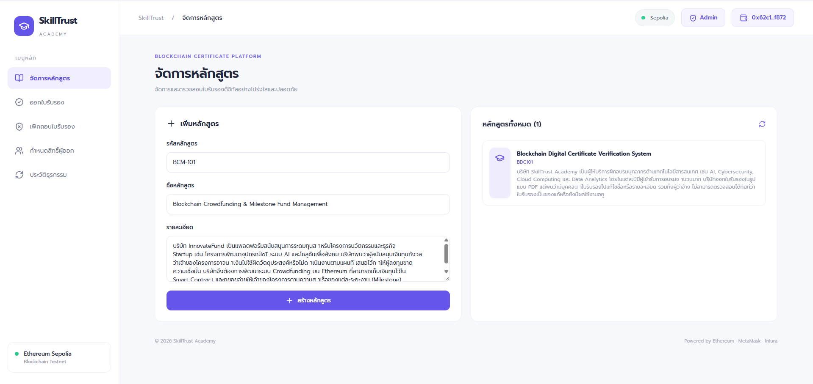
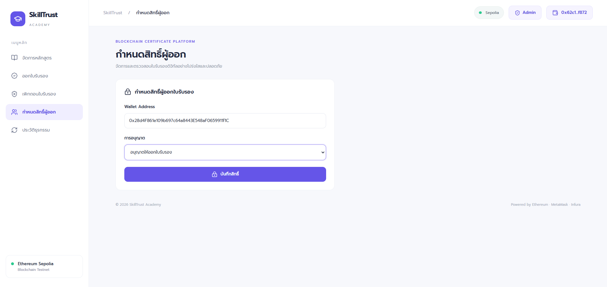
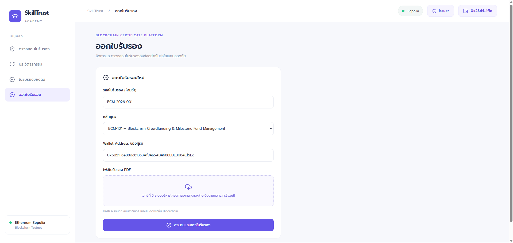
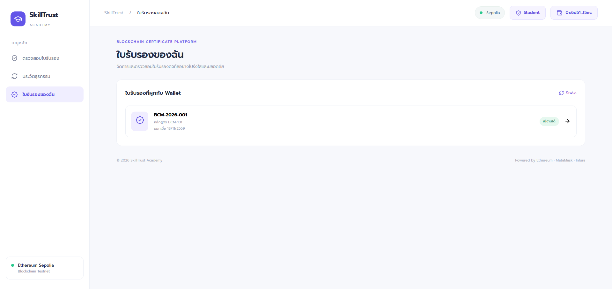
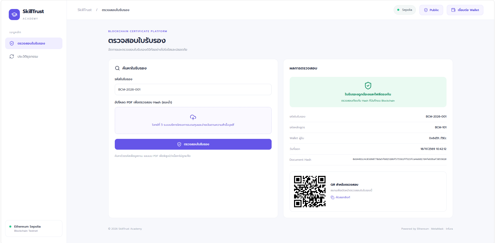
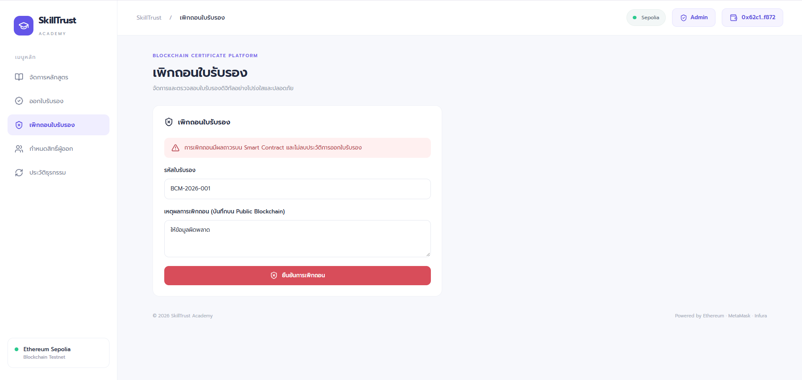
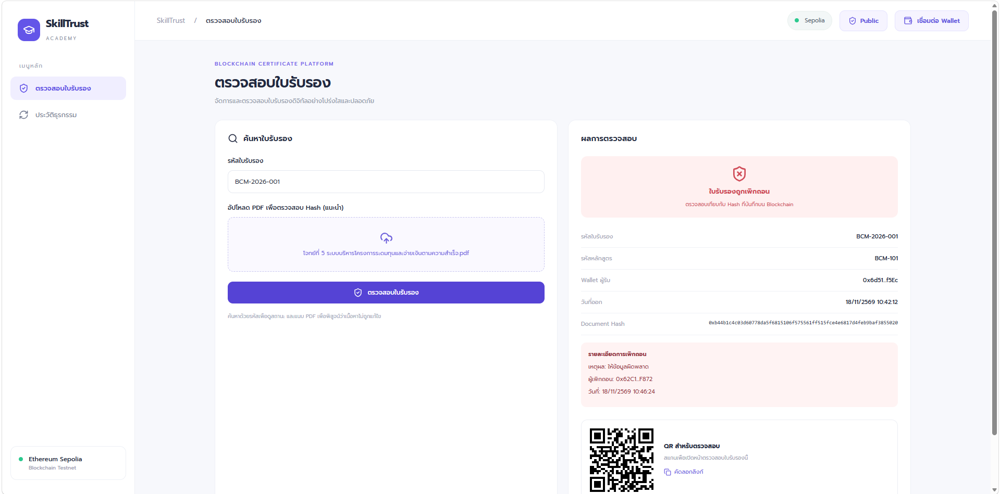
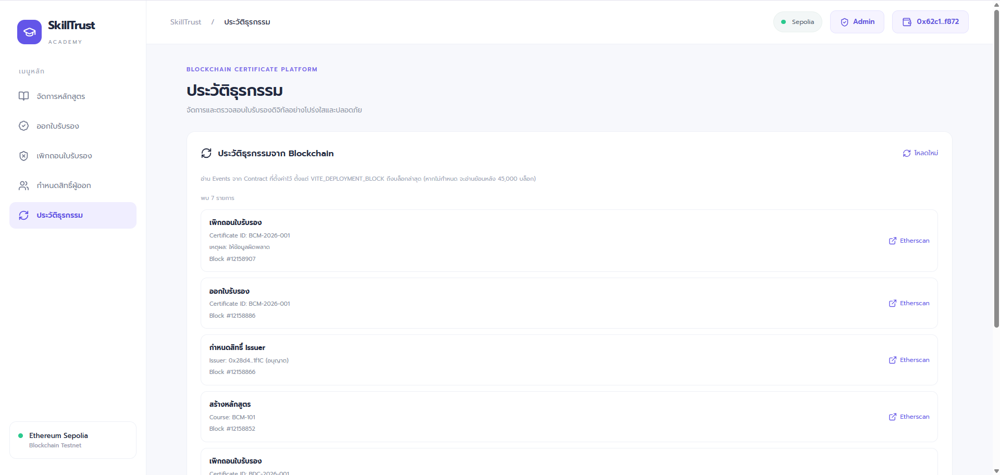
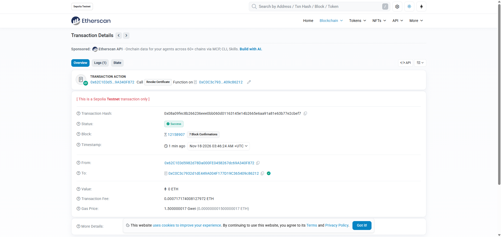
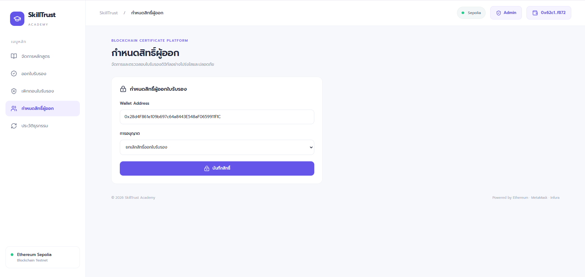

# SkillTrust Academy — Blockchain Digital Certificate Verification System

เว็บออกและตรวจสอบใบรับรองดิจิทัลบน **Ethereum Sepolia** พัฒนาด้วย **React + Vite + ethers.js v6 + Solidity + Remix + MetaMask + Infura** โดยไม่ใช้ฐานข้อมูล MySQL

## ฟังก์ชันตามโจทย์

1. **สร้างหลักสูตร (Admin):** สร้างรหัสหลักสูตร ชื่อ และรายละเอียด โดยป้องกันรหัสซ้ำ
2. **ออกใบรับรอง (Admin/Issuer):** ระบุรหัสใบรับรอง รหัสหลักสูตร Wallet ผู้รับ และ PDF; สร้าง SHA-256 Hash ในเบราว์เซอร์ก่อนบันทึก
3. **เก็บ Hash บน Blockchain:** เก็บ `bytes32 documentHash` โดยไม่อัปโหลด PDF หรือข้อมูลส่วนบุคคลลงเชน
4. **ตรวจสอบ (Public):** ค้นหาด้วย Certificate ID หรือ QR; แนบ PDF เพื่อตรวจสอบว่า Hash ตรงกันจริง
5. **เพิกถอน (Admin):** ระบุเหตุผลก่อนเพิกถอน เก็บเหตุผล ผู้เพิกถอน และเวลาบน Blockchain (ไม่ลบประวัติเดิม)
6. **ใบรับรองของฉัน (Student):** เชื่อม MetaMask เพื่อดูใบรับรองที่ผูกกับ Wallet
7. **ประวัติธุรกรรม (เพิ่มเติม):** อ่าน Events ของ Contract พร้อมลิงก์ธุรกรรม Sepolia Etherscan

## สิ่งที่พัฒนาเพิ่มเติม

## 1. เพิ่มเหตุผลการเพิกถอนใบรับรอง

**ก่อนปรับปรุง:** Admin ระบุรหัสใบรับรองแล้วเพิกถอนได้ แต่ไม่มีช่องระบุสาเหตุ

**หลังปรับปรุง:**
- เพิ่มช่องกรอกเหตุผลการเพิกถอนในหน้าเว็บไซต์
- ส่งเหตุผลไปยัง Smart Contract พร้อมคำสั่งเพิกถอน
- บันทึก Wallet Address ของผู้เพิกถอน และเวลาเพิกถอน
- แสดงเหตุผลและรายละเอียดการเพิกถอนในหน้าตรวจสอบใบรับรอง
- เก็บข้อมูลการออกใบรับรองเดิมไว้ โดยเปลี่ยนสถานะเป็นถูกเพิกถอน

**ประโยชน์:** เพิ่มความโปร่งใสและความสามารถในการตรวจสอบย้อนหลัง 

## 2. เพิ่มหน้าประวัติธุรกรรม

**ก่อนปรับปรุง:** ผู้ใช้ดำเนินการสร้างหลักสูตร ออกใบรับรอง และเพิกถอนผ่านเว็บไซต์ได้ แต่ไม่มีหน้ารวมประวัติธุรกรรมที่อ่านจาก Blockchain อย่างชัดเจน

**หลังปรับปรุง:**
- เพิ่มหน้าแสดงรายการธุรกรรมย้อนหลังจาก Smart Contract Events
- แสดงประวัติการสร้างหลักสูตร (`CourseCreated`)
- แสดงประวัติการกำหนดสิทธิ์ Issuer (`IssuerUpdated`)
- แสดงประวัติการออกใบรับรอง (`CertificateIssued`)
- แสดงประวัติการเพิกถอนใบรับรอง (`CertificateRevoked`)
- เพิ่มลิงก์ Transaction Hash เพื่อเปิดดูรายละเอียดบน **Sepolia Etherscan**
- เพิ่มการตั้งค่า `VITE_DEPLOYMENT_BLOCK` เพื่อเริ่มอ่าน Events ตั้งแต่บล็อกที่ Deploy Contract

**ประโยชน์:** ช่วยให้ตรวจสอบได้ว่ามีการดำเนินการใดเกิดขึ้นบน Blockchain และอ้างอิงหลักฐานธุรกรรมได้โดยตรง

## 3. ปรับปรุงการตรวจสอบใบรับรอง

**ก่อนปรับปรุง:** ค้นหาใบรับรองด้วย Certificate ID และตรวจสอบ Hash ของ PDF ได้

**หลังปรับปรุง:** แยกผลตรวจสอบให้ชัดเจนเป็นกรณีต่าง ๆ ดังนี้

| กรณี | ผลที่ควรแสดง |
|---|---|
| ไม่พบ Certificate ID | ไม่พบใบรับรอง |
| พบใบรับรอง แต่ไม่ได้แนบ PDF | พบข้อมูลใบรับรอง แต่ยังไม่ได้ยืนยันความตรงกันของไฟล์ |
| พบใบรับรองและ PDF Hash ตรง | เอกสารตรงกับหลักฐานบน Blockchain |
| พบใบรับรอง แต่ PDF Hash ไม่ตรง | ไฟล์ไม่ตรงกับหลักฐาน อาจมีการแก้ไข |
| ใบรับรองถูกเพิกถอน | แสดงสถานะเพิกถอน แม้ PDF Hash จะตรงก็ตาม |

**ประโยชน์:** แยกการยืนยันว่า *มีการออกใบรับรอง* ออกจากการยืนยันว่า *ไฟล์ PDF ที่นำมาตรวจสอบเป็นไฟล์เดียวกับที่ออกไว้* 

## 4. ปรับปรุง Smart Contract

เพื่อรองรับฟังก์ชันข้างต้น มีการเปลี่ยนส่วนที่เกี่ยวข้องกับการเพิกถอนและการอ่านข้อมูล ได้แก่

- เปลี่ยนการเรียกเพิกถอนเป็น `revokeCertificate(certificateId, reason)`
- เพิ่มข้อมูลเหตุผล ผู้เพิกถอน และเวลาเพิกถอน
- เพิ่ม `getRevocationInfo(certificateId)` เพื่อเรียกดูรายละเอียด
- ใช้ Events สำหรับแสดงประวัติการดำเนินการ
- คงการตรวจสอบสิทธิ์สำหรับฟังก์ชันที่ Admin หรือ Issuer เท่านั้นที่ดำเนินการได้

## Role

| Role | สิทธิ์ |
| --- | --- |
| Admin | สร้างหลักสูตร, ออกใบรับรอง, เพิกถอนพร้อมเหตุผล, กำหนด Issuer, ดูประวัติ |
| Issuer | ออกใบรับรอง, ตรวจสอบ, ดูใบรับรอง Wallet ตนเอง, ดูประวัติ |
| Student | ตรวจสอบ, ดูใบรับรองของ Wallet ตนเอง, ดูประวัติ |
| Public | ตรวจสอบโดยไม่ต้องเชื่อม MetaMask, ดูประวัติ |

## ติดตั้ง

```bash
npm install
npm run dev
```

## วิธีทดสอบครบทุก Role

1. **Admin** (Wallet ที่ Deploy) สร้างหลักสูตร `BCM-101`


2. **Admin** เพิ่ม Wallet 2 เป็น Issuer ด้วยเมนู `กำหนดสิทธิ์ผู้ออก`


3. **Issuer** (Wallet 2) ออกใบรับรอง `BCM-2026-001` ให้ Wallet 3 และเลือกไฟล์ PDF


4. **Student** (Wallet 3) เปิด `ใบรับรองของฉัน` และกดใบรับรอง


5. **Public** เปิดหน้า Verify โดยไม่เชื่อม Wallet; ค้นด้วยรหัสแล้วแนบ PDF ต้นฉบับ ควรขึ้นไฟล์ตรงกัน


6. แก้ไข PDF และตรวจซ้ำ ควรขึ้นไฟล์ไม่ตรงกับหลักฐาน

7. **Admin** เพิกถอน `BCM-2026-001` พร้อมเหตุผลที่ไม่เป็นข้อมูลส่วนบุคคล


8. **Public** ตรวจซ้ำ ควรขึ้นเพิกถอนแล้วพร้อมเหตุผล


9. เปิดเมนู **ประวัติธุรกรรม** และคลิก Etherscan เพื่อตรวจสอบธุรกรรม



10. **Admin** ยกเลิกสิทธิ์ Wallet 2; Wallet 2 ไม่ควรออกใบรับรองใหม่ได้
